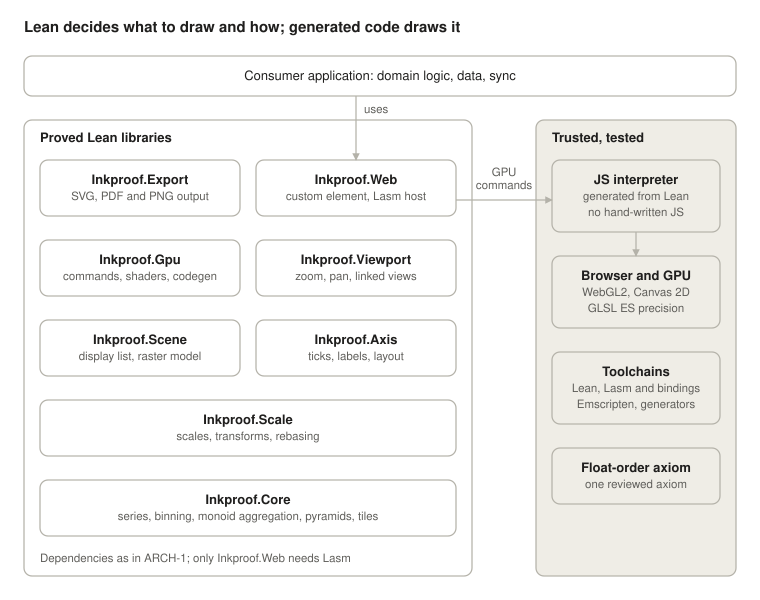

# Inkproof: Verified Charting Libraries for Lean on Lasm: High-Level Requirements

Nov 3, 2026 · @Paul

## Purpose and scope

This document specifies a set of general-purpose Lean 4 libraries for interactive 2D charting, compiled to the browser with Lasm and rendered through WebGL2, in which the path from data to pixels is proved correct.

The libraries target applications that chart large numeric datasets interactively and where a wrong picture is costly: engineering telemetry, scientific instruments, monitoring, and finance. Race-car telemetry is the first consumer, but nothing in the libraries may depend on it.

The libraries must be a serious choice on ordinary grounds (performance, polish, API quality) and must also offer guarantees that conventional charting libraries cannot: every drawn pixel is justified by the data, nothing in the data that should be visible is lost, and interaction never corrupts the view.

The libraries are named `Inkproof.Core`, `Inkproof.Scale` and so on, and each lives in its own repository under the `paulbutcher` GitHub account (`inkproof-core`, `inkproof-scale` and so on).

## Design principles

Six principles govern every requirement below; where a requirement conflicts with one, the principle wins.

1. **No domain leakage.** Libraries know about ordered domains, aggregates, scales and pixels, never about laps, sensors or sampling rates. Domain facts enter only as type-class instances, parameters, or hypotheses that the consumer discharges.
2. **Assumptions are hypotheses.** Any property the code relies on (sortedness, absence of NaN, monotone binning) appears as a typed precondition or a theorem hypothesis, never as an unstated convention.
3. **Prove whatever can be proved.** Effort goes first to aggregation, coordinate mapping, gap handling and interaction invariants, where wrong pictures hide, but cosmetic code (theming, legends) is proved too where feasible. Where a proof is out of reach, a property takes its place and the obstacle is recorded.
4. **Lean decides, JavaScript draws.** All meaning (what to draw, where, and with which GPU commands) is computed in Lean. The JavaScript and GLSL that run in the browser are generated from Lean definitions, and the browser glue (animation frames, resizing, context loss) is written in Lean using Lasm's bindings, so no JavaScript is written by hand.
5. **Generic in types, specific in chart family.** Types are abstracted freely; supported chart forms are limited to 2D Cartesian line, area, bar, scatter and heatmap.
6. **Honest claims.** Every published guarantee states its exact theorem, its hypotheses, and the components it trusts.

## Architecture

The set consists of eight libraries in strict layers; everything that decides what appears on screen and how it is drawn is Lean, and the boundary to untrusted code is a GPU command list executed by generated JavaScript.

Arrows show data flow: the consumer drives Inkproof.Web, which hands GPU command lists to the generated interpreter; everything in the shaded column is trusted rather than proved.

- **ARCH-1** Dependencies: Scale uses Core; Axis uses Scale; Scene uses Core, Scale and Axis; Gpu uses Scene; Viewport uses Scale; Web uses Gpu and Viewport; Export uses Scene. No cycles, and no library imports consumer code.
- **ARCH-2** Two data interfaces separate the layers: the display list says what to draw, with a documented meaning under the raster model; the GPU command list says how, and is the only data passed to JavaScript.
- **ARCH-3** Every library except Inkproof.Web builds natively, on Node and under Lasm from the same source.

## Reuse

- **REUSE-1** Before building something, check whether it already exists: in another Inkproof library, in Lean core, Std, Batteries or Mathlib, in the Lean libraries under the `paulbutcher` GitHub account, or on Reservoir. Use it when it meets PLAT-3 and can be pinned at a release; otherwise record in `DESIGN.md` what was considered and why it wasn't used. A dependency from outside the project is the human's decision.
- **REUSE-2** No code is duplicated between Inkproof libraries. What more than one library needs lives in the lowest library they share, under ARCH-1.

## Functional requirements

Each library has a single responsibility and a stable public API; requirement IDs are referenced by the verification and acceptance sections.

### Inkproof.Core: data, binning and aggregation

- **CORE-1** Provide series types over any linearly ordered x-domain and any value type, with sortedness carried as a proof in the type and a validated constructor that checks or establishes it.
- **CORE-2** Represent missing data explicitly (option values or masks); never encode absence as NaN or a sentinel.
- **CORE-3** Represent gaps as explicit segment boundaries, or accept a caller-supplied gap predicate. The library never infers gaps from sampling rates.
- **CORE-4** Define binning as any monotone function from the x-domain to pixel columns, with instances for integers, fixed-point, and floats.
- **CORE-5** Provide mergeable aggregates as monoids: min, max, first, last, count, sum, pixel-occupancy sets, and their products (for example first/max/min/last).
- **CORE-6** Build and query multi-level aggregation pyramids for any monoid, never merging across segment boundaries.
- **CORE-7** Provide a tiling scheme for pyramids (fixed ranges of nodes per tile) so pyramids can be precomputed, stored and fetched in pieces. Wire encoding is out of scope (see Out of scope).
- **CORE-8** Accept data through an indexable-series interface so callers can supply float arrays, byte buffers or ordinary arrays without copying.

### Inkproof.Scale: scales and transforms

- **SCALE-1** Provide scale kinds: linear, log, elapsed-duration and categorical. Calendar time is a separate optional module (see SCALE-5).
- **SCALE-2** Provide affine transforms between data space and screen space, their composition, and their inverses where defined.
- **SCALE-3** Support rebasing coordinates relative to the current view so values with large magnitudes (such as epoch timestamps) render without precision loss on 32-bit GPUs.
- **SCALE-4** Allow several charts to share one scale by reference, so linked views agree by construction.
- **SCALE-5** Optional calendar-time module: calendar-aware intervals and time zones, with time-zone data treated as a trusted external input.
- **SCALE-6** Allow consumers to attach checked constraints to scale domains (for example "y-domain always includes zero").

### Inkproof.Axis: ticks and labels

- **AXIS-1** Generate "nice" ticks for every scale kind at any range and zoom level.
- **AXIS-2** Format labels with configurable precision, parameterised by a locale definition.
- **AXIS-3** Lay out labels given text measurements supplied by the host, avoiding overlap by thinning or rotation.

### Inkproof.Scene: display list, geometry and reference rasterizer

- **SCENE-1** Define a display-list type with commands for line strips, min/max envelopes, filled areas, rectangles, markers and text, assigned to layers.
- **SCENE-2** Compile series, scales and aggregates into display lists for line, area, bar, scatter and heatmap charts.
- **SCENE-3** Clip all geometry to the plot area.
- **SCENE-4** Generate triangle geometry for thick and anti-aliased lines.
- **SCENE-5** Define an abstract raster model (which pixels a primitive covers) as the specification for rendering.
- **SCENE-6** Provide an executable pure-Lean rasterizer implementing that model, writing to a pixel buffer, for headless rendering, golden tests and fallback.

### Inkproof.Gpu: GPU commands, shaders and code generation

- **GPU-1** Compile display lists into GPU command lists: buffer uploads, reuse of cached buffers, draw order by layer, and uniform values for each draw.
- **GPU-2** Encode each command list as one binary buffer, passed across the Lean–JavaScript boundary in a single call per frame or change.
- **GPU-3** Cache GPU buffers per tile; during pan and zoom, emit only transform-uniform updates and draws.
- **GPU-4** Provide a small Lean language for float32 scalar and vector arithmetic, and generate GLSL ES 3.00 shaders from it. All vertex-shader coordinate math is written in this language.
- **GPU-5** Generate the Lean encoder, the JavaScript decoder and the JavaScript interpreter at build time from one Lean definition of the command set, so they cannot drift apart. Each command maps to one WebGL call.
- **GPU-6** Keep the command set and shader language backend-neutral, so a WebGPU (WGSL) backend can be added later.
- **GPU-7** Ship generated JavaScript and GLSL as readable files in each release, for review.

### Inkproof.Viewport: interaction

- **VIEW-1** Model view state (visible ranges per axis) as a pure state machine driven by input events: wheel, drag, pinch, keyboard, programmatic set.
- **VIEW-2** Support zoom about a point, pan, box-zoom, reset and zoom limits.
- **VIEW-3** Support linked views sharing an axis, and an exposed cursor position in data coordinates.
- **VIEW-4** Expose view changes as events so host applications can synchronise views between users; the synchronisation protocol itself is out of scope.

### Inkproof.Web: browser host (Lasm) and executor

- **WEB-1** Package a chart as a custom element with attributes for its inputs and DOM events for its outputs, usable from plain HTML, hypermedia frameworks such as HTMX or Datastar, Lasm.UI applications, or JavaScript frameworks.
- **WEB-2** Host the generated interpreter (GPU-5) and run it once per frame or change, using WebGL2 for data layers and Canvas 2D for the text layer.
- **WEB-3** Handle device pixel ratio, resizing, WebGL context loss and restoration, and sharing one WebGL context across many charts on a page, all in Lean using Lasm's browser bindings.
- **WEB-4** Supply text measurements from the browser to Inkproof.Axis.
- **WEB-5** Run tile fetching and aggregation off the main thread where the platform allows.
- **WEB-6** Write no JavaScript by hand. If Lasm's bindings lack a browser API the glue needs, add the smallest possible JavaScript shim, list it in the trusted computing base with its line count, and request the binding from Lasm.
- **WEB-7** Log decisions the user can't see (a lost WebGL context, a failed tile fetch, a fallback taken) to the browser console at warn level, with the value that decided them; never log per frame or per data point.

### Inkproof.Export: static output

- **EXPORT-1** Render any display list to SVG and to PDF for reports.
- **EXPORT-2** Render to PNG through the reference rasterizer, without a browser.

## Verification requirements

The central deliverable is an end-to-end theorem: for every pixel column, the drawn extent equals the minimum and maximum of the samples binned to that column, and nothing is drawn where the data has no samples or a declared gap.

### Required theorems

| ID | Library | Property | Priority |
| --- | --- | --- | --- |
| PROOF-1 | Core | Pyramid query equals a fold of the monoid over the raw data, for every monoid and range | Must |
| PROOF-2 | Core | Every sample falls in exactly one bucket per pyramid level; adjacent levels are consistent | Must |
| PROOF-3 | Core | Aggregation never merges data across a segment boundary | Must |
| PROOF-4 | Scene | For x-monotone polylines, first/max/min/last aggregation rasterizes to the same pixels as the full data under the raster model (M4) | Must |
| PROOF-5 | Scale | Scale mappings are monotone and, where defined, invertible; composition of transforms equals the combined transform | Must |
| PROOF-6 | Scale, Gpu | After rebasing, every point is placed within half a pixel of its true position at every zoom level, including the vertex-shader arithmetic as written in the shader language (GPU-4) | Must |
| PROOF-7 | Scene | No line is drawn across a declared gap | Must |
| PROOF-8 | Scene | Clipping keeps all geometry inside the plot area and loses nothing inside it | Must |
| PROOF-9 | Viewport | Zoom about a point keeps that point fixed; zoom limits always hold; zoom in then out restores the view | Must |
| PROOF-10 | Viewport | Linked views share an identical x-transform in every state | Must |
| PROOF-11 | Gpu | Under an abstract model of GPU state, a command list draws every display-list command exactly once, in layer order, with the correct transform; reusing cached buffers gives the same result as uploading afresh | Must |
| PROOF-12 | Axis | Ticks lie within the visible range and are evenly spaced; adjacent labels are distinct; each label parses back to its tick value at the displayed precision | Should |
| PROOF-13 | Axis | Given the host's text measurements, labels never overlap | Should |
| PROOF-14 | Gpu | Decoding an encoded command list returns the original list | Should |
| PROOF-15 | Gpu | The GLSL printer preserves the meaning of shader-language expressions under the GLSL ES precision model | Could |
| PROOF-16 | Scene | Generated line triangles cover the segment they represent | Could |

### Floating-point strategy

- **FP-1** Algorithms are written and proved generically over linear orders, then instantiated for concrete types.
- **FP-2** The float instance relies on one documented axiom: float comparison is a total order on values that are neither NaN nor `-0.0`, which compares equal to `0.0` but is a different value. A wrapper type enforces the precondition, rejecting NaN and turning `-0.0` into `0.0`.
- **FP-3** Where rounding matters (data-to-pixel mapping), properties are proved over real numbers with an explicit sub-pixel error bound for the float implementation; bit-exact float proofs are not required.
- **FP-4** Integer and fixed-point instances are provided so consumers with integer timestamps get exact binning.
- **FP-5** Shader arithmetic is modelled using the precision requirements of the GLSL ES 3.00 specification for `highp` operations, not assumed to be exact IEEE arithmetic.

### Process

- **PROC-1** Every axiom is listed in one file, reviewed, and reported by CI using Lean's axiom check on each published theorem.
- **PROC-2** The build treats warnings as errors, so no `sorry`, admitted goal or `plausible` tactic can reach any module; properties are written out instead.
- **PROC-3** Each public theorem has a plain-English statement in the documentation, linked from the API it covers.
- **PROC-4** Proofs are written extrinsically where practical, so implementation code stays readable to non-specialists.
- **PROC-5** Theorems consumers may rely on are public API: they live in the library, in proof modules kept out of what the browser build links, and their statements are tracked in `API.lock`. Other theorems live in the test subproject, where compiling is passing.
- **PROC-6** Every published operation has a theorem stating what it computes, not only its algebraic laws or invariants; where the proof is out of reach, a property takes its place with the obstacle recorded. The required theorems above are the guarantees the libraries compose, and each relies on these.

## Platform and integration requirements

The Lean libraries must build both natively and with Lasm from the same source, so consumers can run aggregation on a server or in the browser without code changes.

- **PLAT-1** Core, Scale, Axis, Scene and Viewport must not depend on Lasm or any browser API; only Inkproof.Web may.
- **PLAT-2** Track the Lean toolchain version Lasm supports (currently exactly 4.35.0) and document the supported pair in each release.
- **PLAT-3** Any dependency used at runtime, including proof libraries such as Mathlib if used, must be confirmed to work under Lasm; proof-only imports must not add runtime initialisation cost.
- **PLAT-4** Target WebGL2 as the baseline renderer, on current desktop and mobile Chrome, Edge, Safari and Firefox.
- **PLAT-5** Design the executor interface so a WebGPU backend can be added later (including compute-shader aggregation) without changing the display-list type.
- **PLAT-6** Keep calls across the Lean–JavaScript boundary coarse-grained: one call per tile or per frame, never per data point.
- **PLAT-7** Use asynchronous APIs in browser builds so the single-threaded Lean runtime never blocks the page.
- **PLAT-8** Provide a Node build for server-side use (aggregation, tile generation, headless export) and a native build for batch jobs.
- **PLAT-9** Use exact, pinned versions for every JavaScript dependency, and keep the browser-side runtime free of third-party code where possible.

## Non-functional requirements

The libraries must compete with established charting libraries on everyday qualities before their guarantees matter; targets below are initial and will be fixed after a prototype.

### Performance

- **PERF-1** Pan and zoom at 60 fps (p95 frame time under 16.7 ms) on a mid-range phone, with 8 linked charts of 4 series each visible.
- **PERF-2** Per-frame Lean work during pan and zoom limited to computing transforms; geometry is rebuilt only when new tiles arrive.
- **PERF-3** First chart drawn within 1 second of page load on a mid-range phone over a typical broadband connection.
- **PERF-4** Hot generic code specialised per instance (`@[specialize]`), with benchmarks run on the specialised build.
- **PERF-5** Benchmarks run in CI on a fixed device profile; regressions over 10% fail the build.

### Size and compatibility

- **SIZE-1** Report compressed download size per release; target to be set after measuring Lasm's runtime overhead.
- **SIZE-2** Consumers pay only for libraries they import (for example, no calendar-time code unless used).

### Accessibility

- **A11Y-1** Full keyboard control of zoom, pan, cursor and series selection.
- **A11Y-2** Each chart exposes a text summary and an optional data-table view to assistive technology.
- **A11Y-3** Colour palettes meet contrast guidelines in light and dark themes; no information is carried by colour alone.

### API and documentation

- **API-1** A basic interactive line chart takes about 20 lines of Lean.
- **API-2** Every public declaration whose behaviour isn't evident from its name and type has a docstring; examples are tests.
- **API-3** Theming covers colours, fonts, line styles and spacing without touching rendering code.
- **API-4** Libraries follow semantic versioning; breaking changes are listed in release notes.

## Trusted computing base

Proofs cover the Lean source down to the GPU command list and shader expressions; everything below them is trusted, and the project must keep that part small, list it publicly, and test it.

| Component | Why trusted | Mitigation |
| --- | --- | --- |
| Generated JS decoder and interpreter | JavaScript, outside Lean | Generated from one Lean definition (GPU-5); templates reviewed; round-trip tests |
| Generated GLSL shaders | Run on the GPU | Generated from proved shader-language expressions (GPU-4); printer tested, optionally proved (PROOF-15) |
| Code generator templates | Their output is trusted | Few templates, one per argument kind; reviewed; any template bug is systematic, so tests catch it |
| Lasm browser bindings | The Lean glue reaches browser APIs through them | Part of Lasm, pinned with it; any fallback JavaScript shim (WEB-6) is listed here with its line count |
| Lean compiler and runtime | Compiles proved source | Differential tests between native and Lasm builds |
| Lasm compiler, runtime, Emscripten | Compiles Lean to Wasm | Same differential tests; pin versions |
| Browser, GPU driver | Execute WebGL calls and shaders | Visual checks on a device matrix; GPUs assumed to meet GLSL ES precision rules (FP-5); known driver issues documented |
| Float-order axiom (FP-2) | Lean floats are opaque to proofs | One reviewed axiom; wrapper type excluding NaN and `-0.0`; axiom tested on each platform's floats |
| Float rounding model (FP-3) | Lean floats are opaque to proofs | One reviewed axiom, in the IEEE 754 round-to-nearest form for binary64; tested on each platform's floats |
| Host text measurement | Used by label layout (PROOF-13) | Stated as a hypothesis of the theorem |
| Time-zone data (SCALE-5) | External data | Versioned and stated as an input |

- **TCB-1** Publish this table with every release, including the line count of the generator templates and of any hand-written JavaScript shim (target: none).
- **TCB-2** The interpreter and shaders must match the raster model of SCENE-5; any deliberate difference (such as anti-aliasing) is documented with its effect on guarantees.

## Validation

Proofs show the code meets its specifications; validation checks that the specifications are the right ones, that the API is free of domain leakage, and that the trusted components behave.

- **VAL-1 Minimal-structure instances.** Instantiate each abstraction with deliberately impoverished types (an order-only x-type, a non-commutative monoid, non-square pixels, a scale excluding zero). They live in each library's test subproject, where compiling is passing; a failure means an undeclared dependency.
- **VAL-2 Theorem-discharge checks.** For each exotic instance, prove the main theorems' hypotheses and apply the theorems. A hypothesis no realistic consumer can prove is a specification leak.
- **VAL-3 Simulated consumers.** Separate consumer repositories, each with its own agent, use the libraries only through released versions: server metrics (irregular sampling, calendar time, missing scrapes), candlestick charts (OHLC as first/max/min/last), unsorted scatter with duplicate x-values, and histograms or heatmaps. They check properties of their display lists (extents, gaps, ordering), not exact snapshots, and file requests rather than working around limitations.
- **VAL-4 Equivalence with reference implementations.** Prove optimised code equivalent to its naive reference where possible. Where that proof isn't done yet, use Plausible to generate edge cases (empty and single-point series, huge dynamic ranges, constant values, missing runs, enormous lengths, values at calendar boundaries) and compare the two, recording why the proof is out of reach.
- **VAL-5 Real public datasets.** Run the test suite over messy real data (for example seismic, weather and exchange data) as well as generated data.
- **VAL-6 Differential builds.** Run the same inputs through native and Lasm builds and require identical display lists and command lists.
- **VAL-7 Golden images.** Compare browser screenshots with the reference rasterizer's output, within a documented tolerance for anti-aliasing, on a matrix of browsers and GPUs. This is the only place output is compared as pixels.
- **VAL-8 Dependency direction.** CI fails if any library module imports consumer code or if dependencies break ARCH-1.
- **VAL-9 Outsider build.** Before 1.0, someone without the original domain context builds a consumer from the documentation alone; their difficulties are recorded as issues.
- **VAL-10 Round-trip tests.** Encode command lists in Lean, decode and record them in the generated JavaScript, and require identical results across generated cases.
- **VAL-11 Generated-code review.** CI shows a diff of generated JavaScript and GLSL on every change, so template changes are reviewed through their effect.

## Acceptance

Version 1.0 is accepted when a flagship demo built only on these libraries meets every criterion below, alongside all Must theorems and validation checks passing in CI.

The demo charts a year of continuous public seismic recordings from several stations (roughly 3 billion samples per station), with an earthquake catalog overlay, hosted as a static site with precomputed tiles.

- [ ] **ACC-1** Smooth zoom from the full year to individual samples on a mid-range phone, meeting PERF-1 and PERF-3.
- [ ] **ACC-2** Every catalogued earthquake in view is visible at every zoom level and position, including after a "random view" jump (PROOF-1, PROOF-4).
- [ ] **ACC-3** A naive-decimation toggle visibly loses or distorts events; switching back restores them.
- [ ] **ACC-4** No jitter at the deepest zoom, with the proved error bound displayed (PROOF-6).
- [ ] **ACC-5** Station outages shown as gaps, never bridged (PROOF-7).
- [ ] **ACC-6** A pixel inspector shows, for any column, the raw samples, independently computed min and max, and the plain-English statement of the guaranteeing theorem.
- [ ] **ACC-7** An automated input robot runs thousands of random interactions with no cursor drift, desynchronised links or limit violations (PROOF-9, PROOF-10).
- [ ] **ACC-8** Linked stacked traces, station map, tooltips, light and dark themes, keyboard control and SVG/PDF export all work.
- [ ] **ACC-9** A page lists every theorem with links to its source, and the trusted computing base table (TCB-1).
- [ ] **ACC-10** Source for each chart is viewable in the demo and is short (API-1).

## Out of scope

These belong to consumers or to later versions, and must not shape the 1.0 design:

- Domain logic of any kind: laps, sectors, sensors, sampling-rate-based gap detection, derived channels.
- Multi-user session synchronisation, annotation storage and server frameworks (the libraries only expose view-change events, VIEW-4).
- Wire formats for tiles and data transport.
- Polar, 3D, geographic and network charts, and a general grammar of graphics.
- Non-mergeable statistics served exactly from pyramids (medians, quantiles); approximate sketches may come later as a separate library with weaker guarantees.
- Perceptual honesty (axis truncation, aspect ratio, colour choice) beyond the checked domain constraints of SCALE-6.
- Correctness of browsers, GPU drivers and hardware.

## Risks and open questions

The largest risk is dependence on Lasm, a young single-maintainer project; the layering in PLAT-1 limits the damage if it stalls.

| Risk | Effect | Mitigation |
| --- | --- | --- |
| Lasm stalls or diverges | No browser builds | Lower libraries stay platform-free; native and Node paths keep working; only Inkproof.Web needs replacing |
| Lean version pinning | Upgrades blocked by Lasm or proof dependencies | Minimise runtime dependencies; track the supported pair (PLAT-2) |
| Proof effort exceeds budget | Delayed release | Prioritise Must theorems; time-box the rest, falling back to properties with the obstacle recorded |
| Wasm and boundary overhead | Misses PERF targets | One command buffer per frame (GPU-2); transforms-only frames (PERF-2); early benchmark spike |
| Raster model mismatch with GPUs | Guarantees not reflected on screen | Golden-image tests (VAL-7); document anti-aliasing effects (TCB-2) |
| GPUs deviate from GLSL ES precision rules | Precision bound (PROOF-6) fails on some devices | Device-matrix tests at deep zoom; document affected hardware |
| Code generator grows complex | Trusted base grows | Keep commands one-to-one with WebGL calls; limit template count |
| Over-generalisation | Never ships | Fixed chart family (principle 5); acceptance tied to one demo |
| Lasm lacks a browser binding the glue needs | Glue can't be written in Lean | Minimal JavaScript shim, listed in the trusted base (WEB-6); request the binding from Lasm |

Open questions:

- [ ] Which raster model to adopt: aliased coverage only, or a model that includes anti-aliasing?
- [x] Is Mathlib needed at all, and does it work under Lasm without runtime cost? Not used for now; revisit if a proof needs it. It builds and runs under Lasm at Lean v4.35.0, but importing it into a module a program links costs about 350 KB brotli and 100 ms of startup even with no runtime use, while a dependency never imported costs nothing (paulbutcher/inkproof-core#2).
- [ ] What compressed size does Lasm's runtime add, and what SIZE-1 target follows?
- [ ] Can Lasm's binding generator be reused for GPU-5, or is a separate generator needed?
- [ ] How much of the GLSL ES precision model must be formalised for PROOF-6 and PROOF-15?
- [ ] Should the PDF exporter be in Lean or delegate to a JavaScript library in the trusted base?
- [ ] Which seismic network's data and licence to use for the flagship demo?
- [x] Licence for the libraries themselves (for example Apache 2.0)? Apache 2.0, as for Lean and Mathlib, with the standard `LICENSE` file in every repository.
